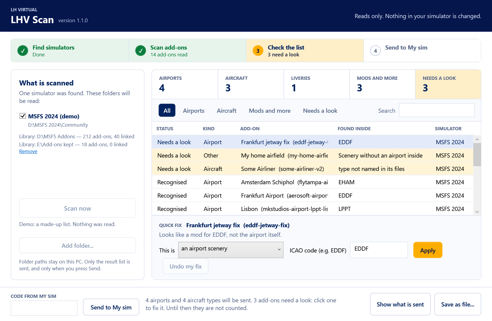

# LHV Scan

A small Windows tool for pilots of [LH Virtual](https://lh-virtual.com). It lists the
airport sceneries and aircraft in your flight simulator, shows you the list, lets you
correct it and sends it to your **My sim** page. LH Virtual then plans flights with
aircraft you own, to airports where you have scenery.

Everything is plain PowerShell. There is no installer and no compiled program:
the three files you download are the source code, and you can read every line.



## What it does, and what it never does

| It does | It never |
|---|---|
| Find your simulators (MSFS 2020, MSFS 2024, X-Plane 11 and 12) | Changes, moves or deletes anything in your simulator |
| Read, per add-on, what kind it is and which airport or aircraft type is inside | Sends anything before you press **Send to My sim** |
| Show the list and let you correct unclear add-ons (**Quick fix**) | Sends folder paths, your user name or anything about your PC |
| Send the list, or save it as a file, when you say so | Lists your liveries, mods or tools by name (they are only counted) |

## How to use it

1. Download the ZIP from your My sim page and unzip it. (From this repository: **Code → Download ZIP** gives you the same files.)
2. Double-click `Start.bat`. The LHV Scan window opens.
3. Press **Scan now**. The window shows which folder is being read.
4. Look at the list. Yellow rows need a look: click one and say what it is.
5. On My sim, press **Connect the scan tool**. Type the code into the tool and
   press **Send to My sim**. Your aircraft and airports appear on the page by themselves.

No code at hand? **Save as file** writes `lhv-addons.json`; upload it on My sim with **Upload file**.

Want a look without a simulator? `powershell -ExecutionPolicy Bypass -STA -File LHV-Scan.ps1 -Demo`
opens the window with a small made-up list.

## The three files

| File | Job | Uses the internet? |
|---|---|---|
| `scan-engine.ps1` | Reads your simulator. Every function is described above its code. | never |
| `scan-send.ps1` | Sends the list. One address, one function. | only when you press Send |
| `LHV-Scan.ps1` | The window: shows, asks, and calls the other two. | no |

`Start.bat` only starts `LHV-Scan.ps1`.

## What is read, exactly

| File | What is taken from it |
|---|---|
| `UserCfg.opt` (MSFS) | one line: where your add-ons are installed |
| `x-plane_install_NN.txt` | one line: where X-Plane is installed |
| `manifest.json` | type, title, maker, creator of an add-on |
| `layout.json` | the list of file names inside an add-on |
| `*.bgl` | only the airport codes stored in a scenery file |
| `aircraft.cfg`, `livery.cfg` | aircraft type, title, "this is a livery" |
| `apt.dat` (X-Plane) | the airport codes of a scenery |
| `*.acf` (X-Plane) | one line: the aircraft type |

### How an add-on is recognised

Names are not trusted first; the add-on's own files are.

- **Airport.** A scenery file (`.bgl`) starts with a table of contents. Section type 3
  holds airports. The tool jumps there and reads one number per airport, its ICAO code.
  Two layouts exist and both are read: older add-ons keep a 4-byte code at byte `0x28`
  of the airport record, add-ons built for MSFS 2024 keep an 8-byte code at byte `0x4C`.
  See `Read-LhvAirportCode` in `scan-engine.ps1`.
- **Aircraft.** `aircraft.cfg` names the type in `icao_type_designator` (for example
  `B77W`). If that line is missing, a model name such as `A-320 CFM SL` is used when it
  clearly contains a type code. A `base_container` line or a `livery.cfg` means livery.
- **Mods and the rest.** Add-ons that are neither get a label from well-known words in
  their name: tree fix, seasons, lighting, terrain mesh, object library, AI traffic,
  navigation data, tools. They are counted, not listed.
- **Needs a look.** Some add-ons are unclear on purpose: a fix that touches an airport
  (it contains the airport, but is not the scenery), a pack with many airports, an
  aircraft that names no type. They are not sent until you decide with **Quick fix**.
  Your decisions are remembered in `%APPDATA%\LHV-Scan\fixes.json`.

## What is sent

Press **Show what is sent** in the tool: that text is the whole message, apart from
your code. The format is described in [docs/FORMAT.md](docs/FORMAT.md). In short:

```json
{
  "format": "lhv-addons/2",
  "tool": "LHV Scan 1.0.0",
  "sims": ["MSFS 2024"],
  "notListed": { "livery": 103, "mod": 21, "unclear": 3 },
  "addons": [
    { "sim": "MSFS 2024", "folder": "aerosoft-airport-eddf-frankfurt", "title": "Frankfurt",
      "maker": "Aerosoft", "kind": "airport", "icaos": ["EDDF"], "aircraftTypes": [], "fixed": false },
    { "sim": "MSFS 2024", "folder": "pmdg-aircraft-77w", "title": "PMDG 777-300ER",
      "maker": "PMDG", "kind": "aircraft", "icaos": [], "aircraftTypes": ["B77W"], "fixed": false }
  ]
}
```

The list goes to one address, `https://lh-virtual.com/api/tours/scan/upload`, together
with the code from your My sim page. The code is valid for one hour and can only be
used to hand in a list for your own profile.

## For developers

```
powershell -NoProfile -ExecutionPolicy Bypass -File tests\Test-Engine.ps1
```

builds a small made-up simulator folder in the temp folder, lets the engine read it and
checks the result (both scenery layouts, aircraft, liveries, mods, X-Plane, Quick fix,
the result file). No simulator is needed.

`tools\Build-Zip.ps1` packs the download (`LHV-Scan.zip`).

Works with Windows PowerShell 5.1, which is part of Windows 10 and 11. The scripts are
kept in plain ASCII so that they read the same in every editor.

## Not affiliated

LH Virtual is a virtual airline for flight simulation. It is not affiliated with
Deutsche Lufthansa AG, Microsoft, Asobo Studio or Laminar Research.
